<h1 align="center">Diego Deiró Software Engineer &nbsp;·&nbsp; Full stack and systems</h1>

  Full stack engineer covering the whole path of a product: web interfaces and APIs, systems software in Rust and Go, and the Linux infrastructure underneath them.

  <a href="https://diego-portfolio-cnm.pages.dev/"><picture><source media="(prefers-color-scheme: dark)" srcset="assets/links/portfolio-dark.svg"></picture></a>&nbsp;
  <a href="https://ordreth.com"><picture><source media="(prefers-color-scheme: dark)" srcset="assets/links/ordreth-dark.svg"></picture></a>&nbsp;
  <a href="https://github.com/ordreth"><picture><source media="(prefers-color-scheme: dark)" srcset="assets/links/github-org-dark.svg"></picture></a>&nbsp;
  <a href="https://www.linkedin.com/in/diego-deiró"><picture><source media="(prefers-color-scheme: dark)" srcset="assets/links/linkedin-dark.svg"></picture></a>

  <picture><source media="(prefers-color-scheme: dark)" srcset="assets/links/english-dark.svg"></picture>

Software engineer working across the full stack. I build web applications and APIs in TypeScript with React, Next.js and NestJS, backed by relational and document databases, and systems software in Rust and Go, from command-line tools and desktop applications to Linux services. My work covers the whole life of a product: architecture, implementation, testing, delivery and maintenance.

AI is part of that practice as well: agent-based workflows with MCP, local language models, LLM integration into applications and prompt engineering. It sits alongside the core engineering work, which rests on typed code, tested behavior and maintainable architecture.

The software I release publicly is published under [Ordreth](https://ordreth.com).

---

### What I work on

Five areas of practice and the tools used in each.

<table>
<thead>
<tr><th align="left" colspan="2"><picture><source media="(prefers-color-scheme: dark)" srcset="assets/icons/layout-dashboard-dark.svg"></picture>&nbsp;&nbsp;Product engineering</th></tr>
</thead>
<tbody>
<tr><td colspan="2">Full stack web applications from schema to interface: typed APIs, authentication, realtime communication, client-side server state and automated tests.</td></tr>
<tr><td width="112" valign="top"><b>Languages</b></td><td> </td></tr>
<tr><td width="112" valign="top"><b>Frontend</b></td><td>        </td></tr>
<tr><td width="112" valign="top"><b>Backend</b></td><td>    </td></tr>
<tr><td width="112" valign="top"><b>Data</b></td><td>       </td></tr>
</tbody>
</table>

<table>
<thead>
<tr><th align="left" colspan="2"><picture><source media="(prefers-color-scheme: dark)" srcset="assets/icons/cpu-dark.svg"></picture>&nbsp;&nbsp;Systems and desktop</th></tr>
</thead>
<tbody>
<tr><td colspan="2">Services, daemons, command-line tools and terminal interfaces where memory, concurrency and the operating system matter, and desktop applications that work offline.</td></tr>
<tr><td width="112" valign="top"><b>Languages</b></td><td>    </td></tr>
<tr><td width="112" valign="top"><b>Libraries</b></td><td>     </td></tr>
</tbody>
</table>

<table>
<thead>
<tr><th align="left" colspan="2"><picture><source media="(prefers-color-scheme: dark)" srcset="assets/icons/server-dark.svg"></picture>&nbsp;&nbsp;Linux and infrastructure</th></tr>
</thead>
<tbody>
<tr><td colspan="2">Declarative, reproducible environments with NixOS and flakes, plus containers and CI pipelines where a project requires them.</td></tr>
<tr><td width="112" valign="top"><b>System</b></td><td>    </td></tr>
<tr><td width="112" valign="top"><b>Delivery</b></td><td>    </td></tr>
</tbody>
</table>

<table>
<thead>
<tr><th align="left" colspan="2"><picture><source media="(prefers-color-scheme: dark)" srcset="assets/icons/shield-check-dark.svg"></picture>&nbsp;&nbsp;Quality and privacy</th></tr>
</thead>
<tbody>
<tr><td colspan="2">Testing at unit, integration and end-to-end levels, static analysis, dependency auditing and fuzzing, with privacy treated as a design constraint.</td></tr>
<tr><td width="112" valign="top"><b>Testing</b></td><td>   </td></tr>
<tr><td width="112" valign="top"><b>Analysis</b></td><td>    </td></tr>
</tbody>
</table>

<table>
<thead>
<tr><th align="left" colspan="2"><picture><source media="(prefers-color-scheme: dark)" srcset="assets/icons/bot-dark.svg"></picture>&nbsp;&nbsp;AI and agents</th></tr>
</thead>
<tbody>
<tr><td colspan="2">Agent workflows with MCP, local language models and LLM integration in software.</td></tr>
<tr><td width="112" valign="top"><b>Tools</b></td><td>  </td></tr>
<tr><td width="112" valign="top"><b>Practices</b></td><td>    </td></tr>
</tbody>
</table>

---

### How I work

The principles that apply to every project.

| Area | In practice |
|---|---|
| **Design** | State, data flow and module boundaries defined explicitly and enforced by strict typing. |
| **Quality** | Unit, integration and end-to-end tests, static analysis, and fuzzing wherever input is untrusted. |
| **Privacy and security** | Local-first design, audited dependencies, minimal data collection and least privilege by default. |
| **Performance** | Concurrency and resource use designed up front and verified by measurement. |
| **Delivery** | Reproducible environments with Nix, CI pipelines, versioned changelogs and written decisions. |
| **AI-assisted development** | Agents, local models and MCP are part of the workflow, held to the same tests, review and security standards as hand-written code. |

---

### Activity

  <picture><source media="(prefers-color-scheme: dark)" srcset="contributions-card-dark.svg"></picture>
    
  <picture><source media="(prefers-color-scheme: dark)" srcset="languages-card-dark.svg"></picture>

